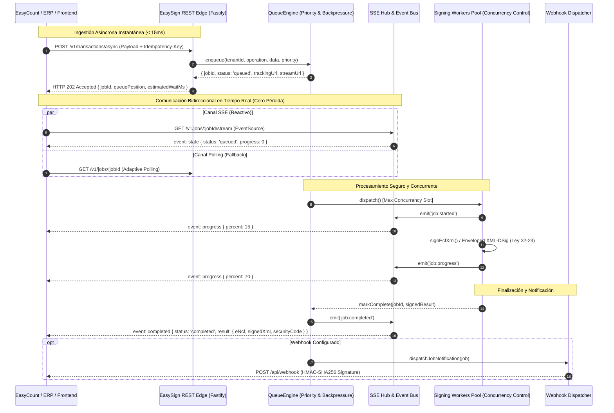

# Arquitectura de Cola de Procesamiento y Comunicación Inter-Servicios (Alta Concurrencia)

## 🎯 Objetivo y Contexto Operativo
En entornos de alta demanda y transacciones masivas (emisión masiva de facturas electrónicas e-CF para la DGII, firma en lote de nóminas o contratos corporativos de gran escala), el procesamiento HTTP síncrono tradicional colapsa por:
1. **Timeouts en pasarelas y proxies (504 Gateway Timeout / 502 Bad Gateway):** El cliente o navegador cierra la conexión antes de que la criptografía asimétrica o los módulos de seguridad (HSM/PKCS#11) concluyan.
2. **Pérdida de comunicación:** Errores de socket (`ECONNRESET`, `ETIMEDOUT`) que obligan al usuario a reenviar la solicitud, provocando duplicación de firmas o rechazos en la DGII.
3. **Saturación de memoria y CPU:** Múltiples solicitudes simultáneas ejecutando operaciones criptográficas pesadas sin límite de concurrencia agotan los hilos de Node.js.

Para resolver esto sin que los usuarios pierdan comunicación en ningún momento, **EasySign** implementa un modelo de **Ingestión No Bloqueante con Cola de Prioridad Asíncrona**, **Identidad Idempotente**, **Streaming SSE (Server-Sent Events)**, **Polling Adaptativo** y **Webhooks Criptográficos**.

---

## 🏛️ Diagrama de Flujo y Arquitectura



---

## ⚙️ Componentes Clave Implementados

### 1. Ingestión con Retorno Inmediato (`HTTP 202 Accepted`)
- El endpoint `POST /v1/transactions/async` valida el esquema mediante **Zod** y encola el trabajo en menos de **15 milisegundos**.
- Devuelve inmediatamente la confirmación al cliente:
```json
{
  "jobId": "es-job-a1b2c3d4-e5f6-7890-abcd-ef1234567890",
  "status": "queued",
  "isIdempotentReplay": false,
  "priority": "high",
  "trackingUrl": "/v1/jobs/es-job-a1b2c3d4-e5f6-7890-abcd-ef1234567890",
  "streamUrl": "/v1/jobs/es-job-a1b2c3d4-e5f6-7890-abcd-ef1234567890/stream",
  "idempotencyKey": "fact-2026-10-00129",
  "queuePosition": 1,
  "estimatedWaitMs": 25
}
```

### 2. Motor de Cola con Prioridad y Control de Concurrencia (`QueueEngine`)
- **Prioridades Dinámicas:**
  - `critical`: Firmas individuales inmediatas (ej. checkout o venta directa en POS).
  - `high`: Facturación regular de clientes.
  - `normal`: Verificaciones y consultas.
  - `bulk`: Lotes masivos de medianoche o importaciones masivas.
- **Control de Concurrencia:** Límite configurable de workers simultáneos (`concurrency: 10`), evitando saturar el servidor o los límites de transacciones por segundo (RPS) de la DGII.
- **Backpressure (Protección contra Congestión):** Capacidad máxima (`maxQueueCapacity: 50,000`). Si la cola se llena, responde `HTTP 429 Too Many Requests` con cabecera `Retry-After: 5`, protegiendo el sistema contra desbordamiento de memoria.
- **Idempotencia Garantizada:** Indexación por `tenantId + idempotencyKey`. Si un cliente reintenta una llamada de red, recibe la misma referencia de trabajo sin duplicar firmas ni cargos.
- **Reintentos con Backoff Exponencial y Dead Letter Queue (DLQ):** En caso de caídas transitorias de red o del HSM, reintenta automáticamente con esperas exponenciales (`baseDelayMs * 2^(intento-1)`). Si se agotan los reintentos, el trabajo pasa a la cola de fallos (DLQ) para auditoría.

### 3. Server-Sent Events (SSE) y Cero Pérdida de Comunicación (`SseHub`)
- Los clientes frontend (EasyCount UI) abren un stream `GET /v1/jobs/:jobId/stream`.
- A medida que el worker avanza (digestión canonical de XML -> cálculo SHA-256 -> firma asimétrica -> generación de código de seguridad DGII), el hub emite eventos `progress` al navegador en tiempo real.
- La conexión se cierra limpiamente al emitir `completed` o `failed`.
- El usuario nunca ve un error de timeout ni una pantalla congelada; visualiza una barra de progreso fluida (0% -> 15% -> 40% -> 70% -> 100%).

### 4. Transacciones por Lotes Masivos (`POST /v1/transactions/batch`)
- Permite enviar hasta **5,000 documentos o comprobantes e-CF en un solo request HTTP**.
- Genera un `batchId` único con seguimiento agregado:
  - `total`, `queued`, `processing`, `completed`, `failed`.
  - Endpoint de consulta: `GET /v1/batches/:batchId`.
  - Stream global para el inquilino: `GET /v1/tenants/:tenantId/stream`.

### 5. Despachador Asíncrono de Webhooks Criptográficos (`WebhookDispatcher`)
- Ejecución desacoplada en segundo plano para notificar a sistemas remotos (EasyCount / Odoo).
- Firma de seguridad en cabecera: `X-EasySign-Signature: t=1792122...,v1=hmac_sha256_hash`.
- Reintentos independientes con timeout de 5 segundos.

---

## 💻 Cliente TypeScript Oficial (`EasySignClient`)

EasyCount y los módulos de Odoo se comunican con EasySign utilizando el cliente oficial [`src/client/easysign-client.ts`](file:///src/client/easysign-client.ts):

```typescript
import { EasySignClient } from "easysign";

const client = new EasySignClient({
  baseUrl: "https://easysign.getupsoft.com",
  tenantId: "flai-srl-001",
  apiKey: process.env.EASYSIGN_API_KEY,
});

// 1. Firma Asíncrona sin bloquear hilo
const result = await client.submitAndWait({
  operation: "sign_ecf_xml",
  data: {
    rncEmisor: "131234567",
    eNcf: "E3100000001",
    amountTotal: 25000.0,
  },
  priority: "critical",
  idempotencyKey: "fact-inv-2026-99",
}, {
  pollingIntervalMs: 50,
  onProgress: (percent) => {
    console.log(`Progreso de firma: ${percent}%`);
  },
});

console.log("XML Firmado DGII:", result.signedXml);
console.log("Código de Seguridad DGII:", result.securityCode);
```

---

## 📊 Métricas y Control de Cola en Tiempo Real
- `GET /v1/queue/metrics`: Devuelve volumen de trabajos en espera, activos, completados, fallidos, throughput por minuto y latencia media.
- `POST /v1/queue/pause` y `POST /v1/queue/resume`: Permite detener la extracción de trabajos para mantenimiento preventivo sin perder ninguna solicitud encolada.
